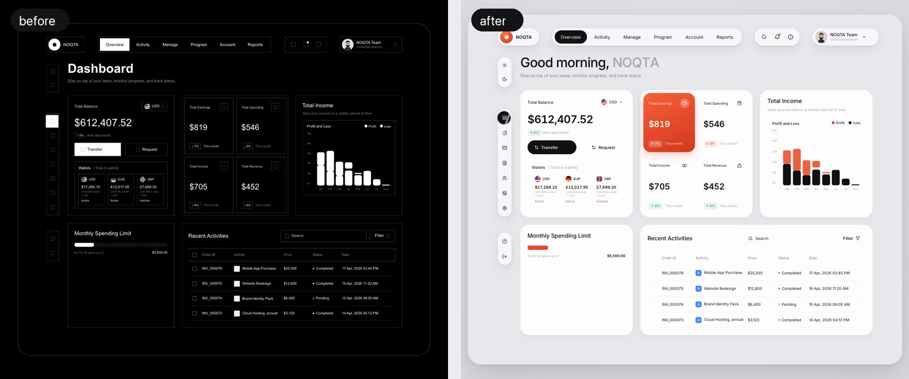
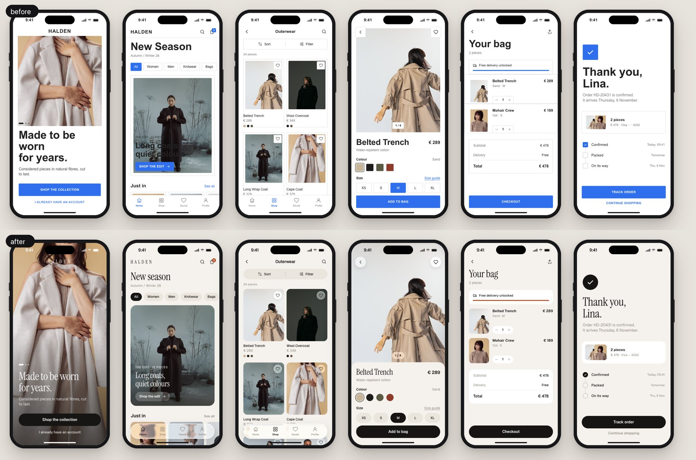

# ui-redesign — from vibe-coded to designed

**By [Achref Arabi](https://github.com/Achref23illi)** · [Instagram](https://www.instagram.com/arabi.achref/) · [LinkedIn](https://www.linkedin.com/in/achraf-arabi/)

[](https://github.com/Achref23illi/ui-redesign/stargazers)
[](LICENSE)


A UI/UX expert for your coding agent that redesigns the product **you already have**:
not one pretty screen, the whole app and its design system. It works on a new git branch,
one layer at a time, so your app is never touched.





<sub>Same layout, same data. Top: a real dashboard taken back to a plain build and designed again. Bottom: six screens of an example fashion app, the generic way and the designed way.</sub>

**If it makes your product better, a ⭐ helps other builders find it.**

## Quick start

```bash
git clone --depth 1 https://github.com/Achref23illi/ui-redesign ~/.claude/skills/ui-redesign
```

Open Claude Code in your project and ask:

- *"Redesign my app with ui-redesign"*
- *"Audit my design system"*
- *"My dashboard looks AI-generated, fix it"*
- *"Review these screens: ./shots"*

## How it works

1. **New branch, always.** Before the first edit it creates `redesign/<scope>`. Your
   working branch, your main branch and your deploys stay exactly as they are. Keep what
   you like, delete the rest.
2. **It audits your design system.** `scripts/audit.py` reads your code and counts what drifted:
   - every colour (with near-duplicates grouped and opacity sprawl flagged);
   - font families, sizes and weights;
   - radii, spacing and shadows;
   - z-index, breakpoints and durations;
   - Tailwind arbitrary values.

   Then it gives a verdict: healthy, tidy or consolidate.
3. **It asks before merging.** When your project has three design systems fighting, it
   proposes one: an 11-step neutral ramp in your tint, one accent, state colours, 6–9 type
   sizes, 3–4 radii and 2–3 shadows. Every old value is mapped onto it, and it waits for
   your yes.
4. **One layer per commit**, each with before/after screenshots:

   | # | Layer | What changes |
   |---|---|---|
   | 1 | type | one scale, 2–3 weights, tabular numbers |
   | 2 | colour | one accent, a real neutral ramp, states that mean something |
   | 3 | shape & space | one radius personality, 4-pt spacing, one gutter |
   | 4 | imagery | real photos at fixed ratios, full-bleed heroes |
   | 5 | icons | one set, one stroke, labels on actions |
   | 6 | components & states | 44/40/36 buttons; hover, focus, loading, empty and error states |
   | 7 | data | hero figures, one chart per card, quiet axes |
   | 8 | depth & glass | 2–3 shadows, liquid glass only over moving content |

5. **Design only.** Same routes, data, copy and behaviour. UX problems it notices come back
   as suggestions, built only if you say so.

## What's inside

- **`SKILL.md`** — the ground rules, the workflow, the exact messages the agent sends you, numbers for web and app, the big-project order, the AI-slop tells and the checklist.
- **`scripts/audit.py`** — the design-system drift report, the verdict and a token proposal with the legacy → token map. Python standard library only; it reads, never writes.
- **`scripts/shots.py`** — screenshots of every route at phone and desktop width, contact sheets, and before/after pairs.
- **`references/design-system.md`** — token tiers, healthy scale sizes, how to merge a drifted system, and token formats for CSS variables, Tailwind v3/v4, shadcn/ui, React Native, SwiftUI and Flutter. Also migration with aliases, codemods and a lint guard.
- **`references/layers.md`** — the eight layers with numbers, code and commit messages.
- **`references/large-projects.md`** — inventory, branch plan, order of work, codemods, visual regression, feature-flagged rollout and monorepos.
- **`references/anti-slop.md`** — 22 things that make a UI look AI-generated, each with its fix, plus a 30-second test.
- **`references/glass.md`** — liquid glass with real lens refraction (SVG displacement map in `backdrop-filter`), fallbacks and native versions.
- **`references/review.md`** — a fast review scored per layer, reported as a table.
- **`AGENTS.md`** — the same workflow for Codex, Cursor, Gemini CLI and other agents.

For mobile screens in depth (rules measured on 4,500 screens of 78 shipped apps), pair it
with **[ui-craft](https://github.com/Achref23illi/ui-craft)**.

## Try the audit on your project

```bash
python3 ~/.claude/skills/ui-redesign/scripts/audit.py . --out redesign-audit.md --propose redesign-tokens.md
```

A real result, from an 829-file monorepo (web, admin and two Expo apps):

```text
Consolidation recommended. 11 of 13 categories are over their healthy limit.
colors 60 (23 near-duplicate groups) · font sizes 37 · radii 44 · tailwind arbitrary values 417
4 % of colour references go through tokens · near-black typed 12 different ways · white at 25 opacities
```

## Setup

**Claude Code, all projects**

```bash
git clone --depth 1 https://github.com/Achref23illi/ui-redesign ~/.claude/skills/ui-redesign
```

**Claude Code, one project** (committed, shared with the team)

```bash
git clone --depth 1 https://github.com/Achref23illi/ui-redesign .claude/skills/ui-redesign
```

**Codex, Gemini CLI, Aider and other agents**: clone it anywhere (for example
`~/.agents/ui-redesign`) and add one line to the project's `AGENTS.md` or `GEMINI.md`:

```markdown
Before any UI, redesign or design-system work, read ~/.agents/ui-redesign/SKILL.md and follow its ground rules and workflow.
```

**Cursor**: clone it into `.cursor/ui-redesign` and create `.cursor/rules/ui-redesign.mdc`:

```markdown
---
description: UI redesign, design system and UI review
globs: ["**/*.tsx", "**/*.jsx", "**/*.vue", "**/*.svelte", "**/*.css", "**/*.swift", "**/*.dart"]
---
Read .cursor/ui-redesign/SKILL.md and follow its ground rules (new branch, ask before merging the design system) and workflow.
```

**Requirements**:
- `audit.py` needs only Python 3.8+.
- `shots.py` needs `pip install playwright pillow && playwright install chromium`. Any running local URL works; for native apps, put Simulator or emulator screenshots in a folder and use `--compare`.

## Free for everyone

MIT licensed. Use it on client work, fork it, teach with it. If you post a before/after made
with it, tag [@arabi.achref](https://www.instagram.com/arabi.achref/). I'd love to see it.
